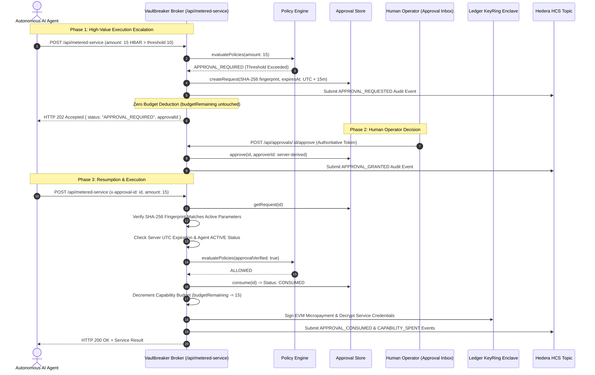

# Vaultbreaker 2.0 Authorization Flow

## 1. Executive Authorization Pipeline Overview

The Vaultbreaker authorization flow defines the deterministic decision pipeline whenever an autonomous AI agent attempts to execute a metered service call (`POST /api/metered-service`). Every request passes through sequential evaluation stages before any private credential is decrypted or any payment is processed.

```
[Incoming Agent Request: POST /api/metered-service]
                     │
                     ▼
┌────────────────────────────────────────────────────────┐
│ Stage 1: Request Parsing & JWT Verification            │
│          • Verify cryptographic JWT signature          │
│          • Extract capId, nonce, expiry, issuer        │
└────────────────────────────────────────────────────────┘
                     │
                     ▼
┌────────────────────────────────────────────────────────┐
│ Stage 2: Capability Validity & Expiration Check       │
│          • Verify capId exists in registry             │
│          • Enforce: currentTime < expiry (UTC)         │
│          • [Failure] ──> HTTP 402 CAPABILITY_EXPIRED   │
└────────────────────────────────────────────────────────┘
                     │
                     ▼
┌────────────────────────────────────────────────────────┐
│ Stage 3: Authoritative Revocation Check                │
│          • Enforce: capability.revoked == false        │
│          • [Failure] ──> HTTP 403 CAPABILITY_REVOKED   │
└────────────────────────────────────────────────────────┘
                     │
                     ▼
┌────────────────────────────────────────────────────────┐
│ Stage 4: Agent Lifecycle Authorization Gate            │
│          • Enforce: capability.agentId == agent.id     │
│          • Enforce: agent.status == "ACTIVE"           │
│          • [SUSPENDED] ──> HTTP 403 AGENT_SUSPENDED    │
│          • [REVOKED]   ──> HTTP 403 AGENT_REVOKED      │
└────────────────────────────────────────────────────────┘
                     │
                     ▼
┌────────────────────────────────────────────────────────┐
│ Stage 5: Least-Privilege Action & Scope Enforcement    │
│          • Enforce: requestedAction in allowedActions  │
│          • Enforce: requestedResource in resourceScope │
│          • [Failure] ──> HTTP 403 ACTION/SCOPE DENIED  │
└────────────────────────────────────────────────────────┘
                     │
                     ▼
┌────────────────────────────────────────────────────────┐
│ Stage 6: Deterministic Policy Engine Evaluation        │
│          • Order applicable policies by priority DESC  │
│          • Precedence: Explicit DENY overrides ALLOW   │
│          • Enforce: Price ceiling (maxPricePerCall)    │
│          • Enforce: Velocity limit (calls/min)         │
│          • Enforce: Active hours (allowedHoursUtc)     │
│          • Enforce: Blocked actions & resources        │
│          • Enforce: requireApprovalAbove threshold     │
│          • [DENY] ──> HTTP 403 POLICY_DENIED           │
│          • [Zero Budget Deduction on failure/escalate] │
└────────────────────────────────────────────────────────┘
                     │
                     ├───────────────┐
                     │ (If Escalated │ without x-approval-id)
                     ▼               ▼
┌─────────────────────────┐  ┌───────────────────────────────────────────────────────┐
│ Stage 6.5: Escalation   │  │ Stage 6.6: Human Approval Resumption                  │
│   • Create Approval     │  │ (When x-approval-id header supplied)                  │
│     Request (PENDING)   │  │   • Verify status == APPROVED                          │
│   • Compute SHA-256 FP  │  │   • Check server UTC currentTime < expiresAt          │
│   • Log HCS Event       │  │   • Verify SHA-256 Request Fingerprint integrity      │
│   • Return HTTP 202     │  │   • Re-evaluate non-overridable checks (Agent ACTIVE, │
│     APPROVAL_REQUIRED   │  │     Capability unrevoked/unexpired, Scope, Budget)    │
│   • ZERO budget deduct  │  │   • Atomically mark approval as CONSUMED (No Replay)  │
└─────────────────────────┘  └───────────────────────────────────────────────────────┘
                                     │
                                     ▼
┌────────────────────────────────────────────────────────┐
│ Stage 7: Exact-Budget Accounting & Execution           │
│          • Enforce: budgetRemaining >= amount          │
│          • [Failure] ──> HTTP 402 INSUFFICIENT_BUDGET  │
│          • Decrement budget: budgetRemaining -= amount │
│          • Decrypt API credential via Ledger KeyRing   │
│          • Dispatch metered payload to service API     │
│          • Log CAPABILITY_SPENT audit event to HCS     │
│          • Return HTTP 200 + Result + Evaluation Trace │
└────────────────────────────────────────────────────────┘
```

---

## 2. Sequence Diagram: Metered Request Pipeline with Human Approval



---

## 3. Standard Reason Codes Taxonomy

| Category | Reason Code | HTTP Status | Description |
|---|---|---|---|
| **Success** | `AUTHORIZED` | 200 | Request satisfied all capability bounds and policy criteria. |
| **Escalation** | `APPROVAL_REQUIRED` | 202 | Request exceeds policy threshold; paused pending human operator authorization. Zero budget deducted. |
| **Approval Gate** | `APPROVAL_NOT_APPROVED` | 403 | Resumption attempted with an approval request that is still `PENDING`, `REJECTED`, or `CANCELLED`. |
| **Approval Gate** | `APPROVAL_EXPIRED` | 403 | Approval authorization window elapsed before agent resumption. |
| **Approval Gate** | `APPROVAL_ALREADY_CONSUMED` | 403 | Approval was already consumed. Replay attack blocked. |
| **Approval Gate** | `APPROVAL_FINGERPRINT_MISMATCH` | 403 | Invocation parameters do not match cryptographically bound parameters. |
| **Agent Gate** | `AGENT_SUSPENDED` | 403 | Owning agent is temporarily paused by administrative control. |
| **Agent Gate** | `AGENT_REVOKED` | 403 | Owning agent has been permanently decommissioned. |
| **Agent Gate** | `AGENT_MISMATCH` | 403 | Attempt to execute capability under an unauthorized agent identity. |
| **Capability** | `CAPABILITY_EXPIRED` | 402 | Capability validity period has elapsed (`currentTime >= expiry`). |
| **Capability** | `CAPABILITY_REVOKED` | 403 | Capability token was explicitly revoked by issuing developer. |
| **Scope** | `ACTION_NOT_PERMITTED` | 403 | Requested action is not declared in `allowedActions`. |
| **Scope** | `RESOURCE_OUT_OF_SCOPE` | 403 | Target endpoint path is outside granted `resourceScope`. |
| **Policy** | `POLICY_DENIED` | 403 | Explicit `DENY` policy guardrail matched the request context. |
| **Policy** | `PRICE_LIMIT_EXCEEDED` | 403 | Cost per call exceeds policy price ceiling (`maxPricePerCall`). |
| **Policy** | `VELOCITY_LIMIT_EXCEEDED` | 403 | Request frequency exceeds sliding-window rate limit (`maxCallsPerMinute`). |
| **Policy** | `TIME_WINDOW_VIOLATION` | 403 | Current UTC execution hour falls outside permitted `allowedHoursUtc`. |
| **Policy** | `BLOCKED_ACTION` | 403 | Action name is prohibited by policy blacklist. |
| **Policy** | `BLOCKED_RESOURCE` | 403 | Resource endpoint is prohibited by policy blacklist. |
| **Accounting** | `INSUFFICIENT_BUDGET` | 402 | Requested spend amount exceeds `budgetRemaining`. |

---

## 4. Zero Budget Deduction Invariant

A strict invariant of the Vaultbreaker authorization pipeline is:
> **Financial balance and capability budget tokens are ONLY decremented upon successful completion of all upstream security stages (Stages 1 through 6) and valid consumption of an approved request.**

If a request:
- Escalates to human approval (`APPROVAL_REQUIRED`)
- Is rejected by an operator (`REJECTED`)
- Expires before being acted upon (`EXPIRED`)
- Fails fingerprint validation or non-overridable security checks

The transaction is aborted without side effects, the failure reason is recorded in HCS, and the agent's remaining budget is preserved with 100% mathematical integrity.
